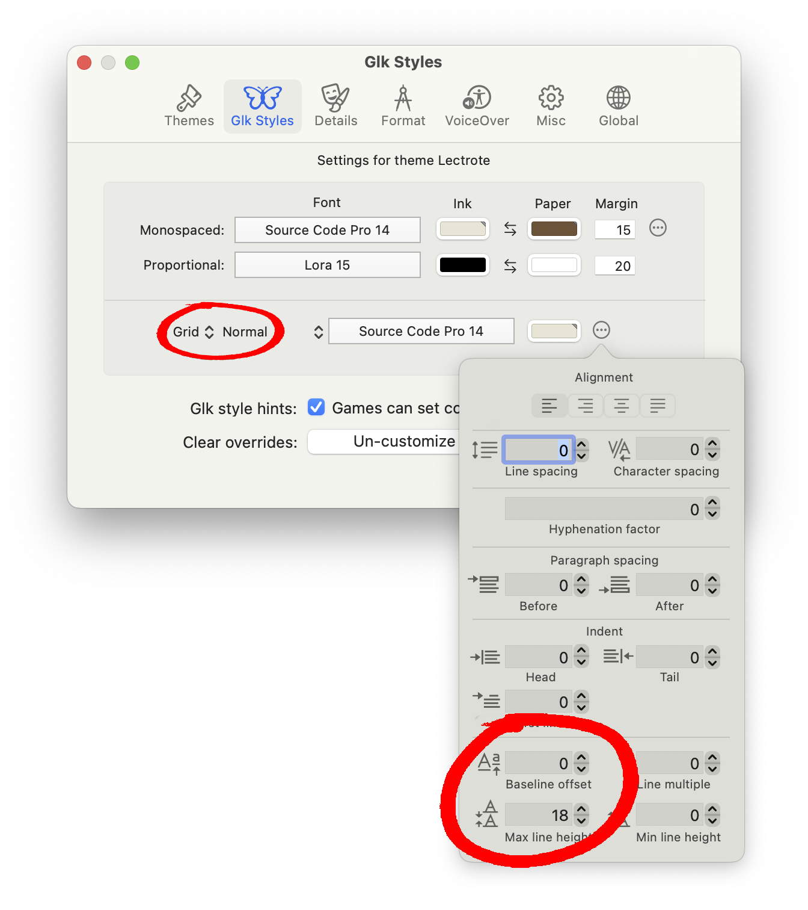
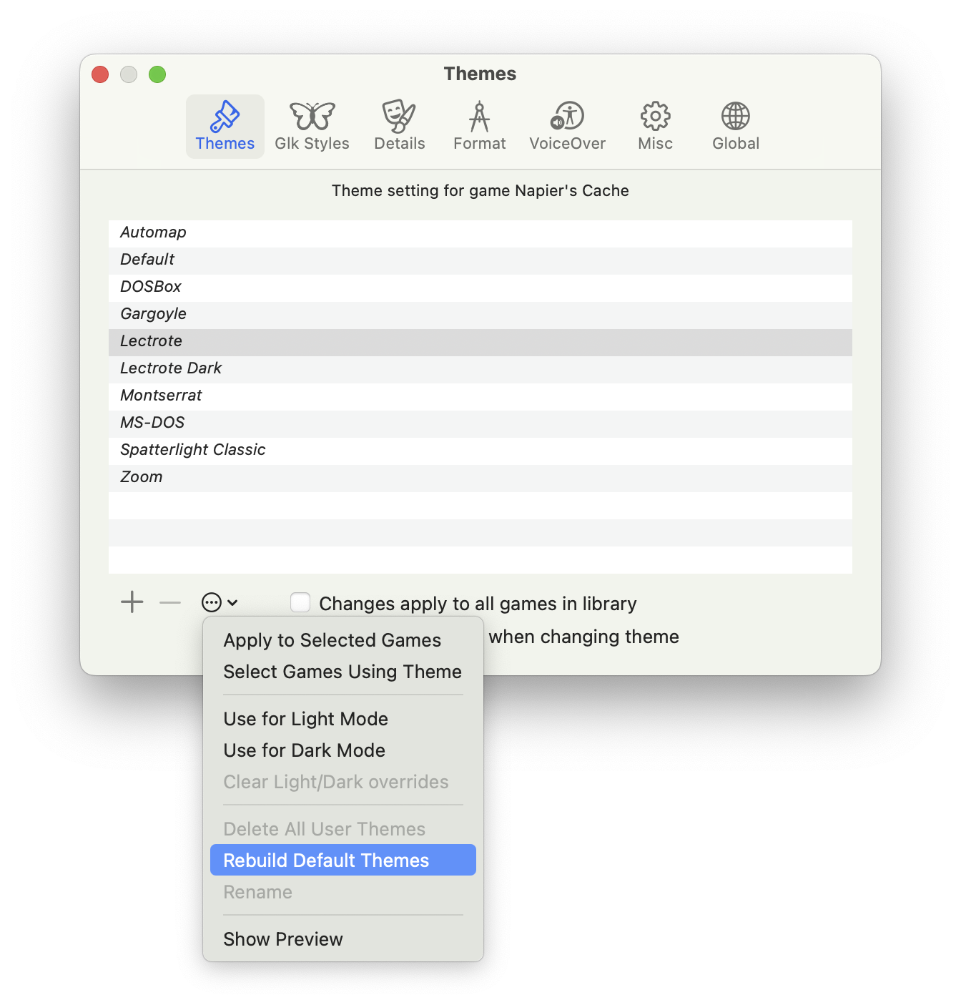
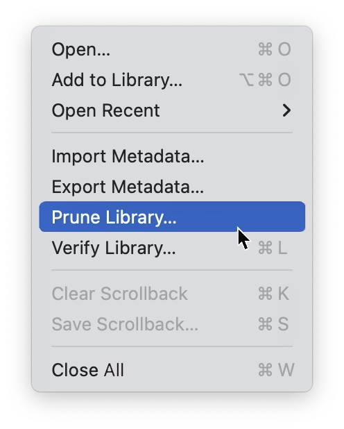
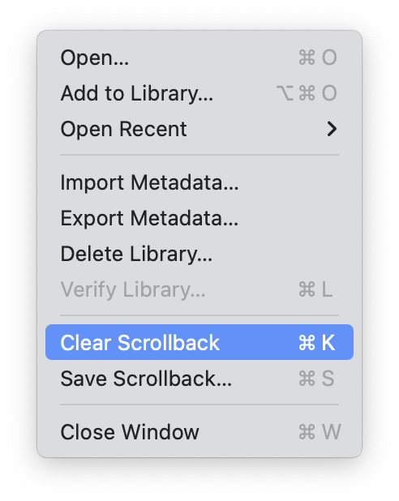
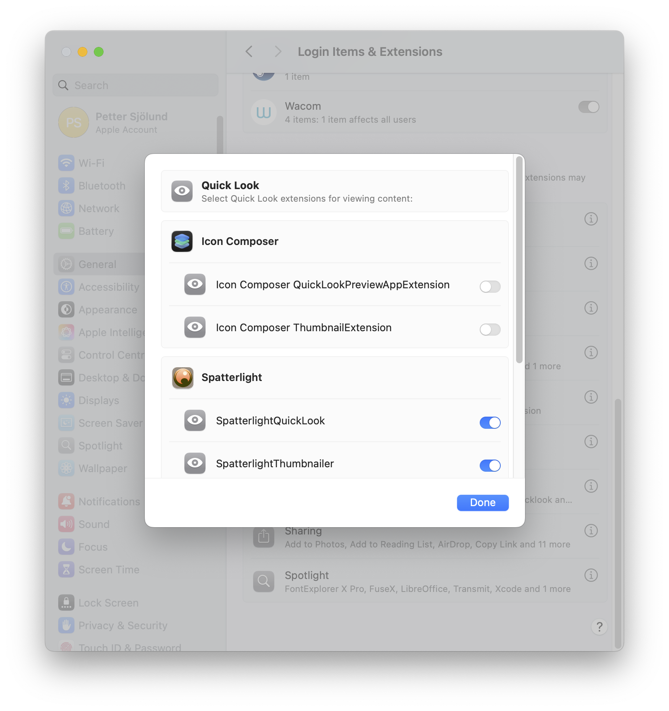

# Fixes for common problems

## Spatterlight crashes on startup

This should never happen, but usually means that Spatterlight tried to read a library database from a previous version, and failed.

You can usually fix this by deleting or removing the database files in `~/Library/Group Containers/6U7YY3724Y.group.net.ccxvii.spatterlight/`. There are three database files in there named `Spatterlight.storedata`, `Spatterlight.storedata-shm`, and `Spatterlight.storedata-wal`.

Move or delete them, and then try running Spatterlight again. All the information in your library will unfortunately be gone.

## Game does not start, just shows a blank window

This is most likely caused by an old incompatible autosave. It should fix itself if you reset the game with the ⌥⌘R shortcut (Option + Command + R) although you will lose any progress in the old autosave file. If this does not work, please report it as a bug! 

## Weird text in status bar

If text is cut off or line spacing looks wrong in the status bar or other grid text windows, it might be fixed by changing the paragraph settings of the Grid Normal style.

You do this on the Glk Styles tab of the settings window, by setting the pop-up menus below the line (set to Buffer Input by default) to Grid Normal (the first one to Grid, the second to Normal) and then opening the paragraph settings pop-up sheet for this style by clicking the "ellipsis in a circle" button to the right.

Baseline offset and Max line height are the most likely culprits. You probably want to set both to 0.

  

## Text too small or too large

You can change the text size on-the-fly with the "⌘ +" and "⌘ -" shortcuts (command plus and command minus key combos.) This will also adapt relevant paragraph settings such as line spacing and maximum line height to the new size. "⌘ 0" (command zero) will reset the text size to its default value.

## Other font setting problems

If one of the built-in themes does not seem to work as it should, you can delete and re-create all built-in themes with the Rebuild Default Themes menu item on the Themes Settings tab. (The "ellipsis in a circle" icon below the list.)

  

## A game is shown in the wrong colours or styles

Games are allowed to set their own text colours and styles, and some do so in ways that look wrong against your theme, or that were never meant for a dark background. You can prevent this in all games by unchecking "Games can set colors and styles" on the Glk Styles tab of the settings window. The setting is per theme.

In the Adrift and Quest interpreters, there are special commands to switch off just the text colours, but not the styles. Type `COLOURS OFF` at the game prompt in Quest games or `GLK COLOURS OFF` in Adrift games.

## Scanlines, glow, no visible cursor?

The built-in MS-DOS and DOSBox themes try to create a retro look by switching on CRT glow and CRT scanlines on the Details tab of the settings window. The effects not shown if either Increase contrast or Reduce transparency is on in System Settings > Accessibility > Display, so if they don't show up, check there first.

The shape of the input cursor is set per theme as well, with the Cursor shape menu on the same tab. If you can't find the cursor, make sure it is not set to None.

## Getting rid of game information

When a game is deleted on the Interactive Fiction library window, Spatterlight will remember all metadata such as title and cover image, so that they will still be there if you open the deleted game again. To completely get rid of metadata after deleting a game, select the "Prune Library…" command by holding down the option key (⌥) while opening the File menu. As a nuclear option, you may also "Delete Library…", which will delete all of your metadata along with all of your games. (From the database, that is. The actual game files will be unaffected.) 

  

## Slowdowns

Spatterlight limits how much text is kept in each scrolling text window. When a game has printed more than this, the oldest text is trimmed away. The limit is set per theme, with the Scrollback limit setting on the Details tab of the settings window. The default is 30000 characters. Setting it to 0 means unlimited scrollback, with no trimming.

If a game becomes slow and unresponsive after printing a lot of text, check that the Scrollback limit of its theme is not set to 0 or to a very large number. As a quick fix, the File > Clear Scrollback command (⌘K) will delete all the text printed so far.

  

## VoiceOver reads the whole game from the start

When a game window is activated, VoiceOver is placed at the latest move rather than the start of the text, but moving the VoiceOver cursor between game windows can still make it scroll to the top and read everything. If that happens, switch on Limit VoiceOver to Last Move in the Speech menu (⌥⌘T, Option + Command + T). It is remembered between sessions, and with it on VoiceOver only sees the text from the last move. Earlier moves are still reached through the Command history rotor, the Speak Previous Move command (⌥⌘↑) and VoiceOver's text search (VO + F).

Repeat Last Move (⌥⌘←) interrupts VoiceOver and speaks the latest move again. You may also want to uncheck Animate scrolling on the Details tab, as the animation can cause VoiceOver to beep.

See [ACCESSIBILITY.md](ACCESSIBILITY.md) for everything else about playing with VoiceOver.

## Playing games without adding them to the library

You may just want to play a game without it getting added to the library. There is a setting for this in the Open… dialog (the file dialog with the text "Please select a game".) Press the Show Options button to reveal the Add to library checkbox.

There is a setting for this on the Global settings tab as well. Here you can uncheck "Add games to library when opened", and also "Show library window automatically" if you don't want to see the library window at all.

## Custom Finder icons and previews

By default, Spatterlight will install Finder extensions which provide custom previews and icons for many supported file types. If you don't want these, they can be turned off in System Settings > Login Items & Extensions > Quick Look > Spatterlight.

  

